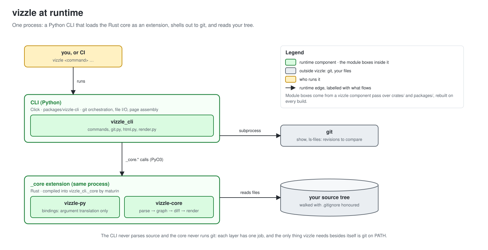

# Hybrid diagram

**Status:** v1 implemented — a port of h's generator, byte-identical on its pictures (`docs/plans/impl/hybrid.md`).
**Command:** `vizzle hybrid [NAME ...] [--dir DIR] [--root ROOT] [--check] [--png]`

vizzle's third diagram type. The class and component diagrams draw what the code IS and lay themselves out. A
hybrid picture draws what RUNS — processes, containers, stores and the runtime edges between them — opened up to
show the code modules each one runs. **A person chooses the layout and writes the runtime layer; vizzle supplies
the module layer fresh on every build, refuses any disagreement, and lints its own picture.**



| | `component` | `hybrid` |
|---|---|---|
| Source | the code | a hand-written `DIR/<name>.json`, plus the code |
| Layout | mermaid's (or the HTML page's) | yours: coarse coordinates; labels, routing and lint by vizzle |
| Shows | modules and imports | processes, stores, runtime edges, and the modules inside them |
| Held to the code | always, because it *is* the code | every build: drift fails it (`--check` in CI) |
| Cost of a change | none | edit a spec, regenerate, look at the PNG |

Choose it for a picture people keep coming back to — a deck slide, an onboarding overview, a design doc's runtime
view — where a stable, readable layout matters more than editing speed. For "what is in this repo", `component`
is still the answer.

## 1. The two kinds

- **runtime** — what RUNS. Processes, containers and stores, each opened into the code modules it runs, with the
  runtime edges between them (spawn, POST, publish). vizzle supplies the module layer through one or more
  **passes**, so a new, renamed or split package fails the build until the spec places it or omits it with a
  reason. A runtime spec may have no pass when its subject is not modules (h's event-fabric picture: streams and
  buckets), and is then held by cited paths alone.
- **concept** — what a primitive or a topology IS. No pass (`"vizzle": []`); every box that stands for a real thing
  (a template, a reconcile, a CLI command) cites a source `path`, so a rename fails the build.

h names its files `<scope>-runtime` and `<scope>-concept`; vizzle does not read the suffix.

## 2. The command

| | |
|---|---|
| `NAME` | pictures to build (spec stems); none = every `*.json` in `DIR` except the pass table |
| `--dir` | where specs live; default `ROOT/docs/diagrams/hybrid`. A given path is a shell path (relative to the current directory). SVGs go to its **parent** (`<name>.svg`), PNGs to `<parent>/rendered/` |
| `--root` | the repository the passes run over and cited paths resolve against; default `.` |
| `--check` | build in memory, compare with the committed SVG byte for byte, write nothing |
| `--png` | also screenshot each SVG at 2x with headless Chrome (`$CHROME`, else a standard install, else `google-chrome`/`chromium` on `PATH`). SVGs need nothing |

Exit codes, the split `doc --check` and `overlay --check` use:

- `0` — built, or every SVG matches a fresh build;
- `1` — the spec disagrees with the code (drift), the picture fails its layout lint, or a committed SVG is stale.
  Nothing is written for that picture or any after it; every finding is listed as `✗ [<name>] drift: …` or
  `✗ [<name>] layout: …`, naming the box and the rule;
- `2` — could not run: an unreadable or non-JSON spec, an unknown field, an id that names no node, an undefined
  pass, a bad pass table, `--png` with no browser.

```sh
vizzle hybrid --dir examples/hybrid --png     # build + screenshot: examples/vizzle-runtime.svg, examples/rendered/…png
vizzle hybrid --check --dir examples/hybrid   # what CI runs
vizzle hybrid system-runtime --root ../h      # one picture of another checkout
```

### 2.1 Passes

`DIR/vizzle-passes.json` names each pass and the `vizzle component` arguments it runs with, over `ROOT`:

```json
{ "passes": { "self": { "args": ["-I", "crates/**", "-I", "packages/**"] } } }
```

A pass runs **in-process**, parsed by `component`'s own option parser and read as the component graph JSON
(`component::to_json`), never mermaid. Only options that shape the graph count (`-I`, `-E`, `-l`, `--tests`,
`--split`, `--highlight`, `--around`, `--depth`); a drawing option (`--weights`, `--group`, `-o`, …) is refused,
since the picture would silently ignore it. A directory of concept specs needs no pass table.

The core reads the table (`hybrid::pass_table`) and the passes a spec names (`hybrid::spec_passes`); the CLI only
finds the files and hands each pass's arguments to `component`'s parser. Besides the shape above, a field the table
does not know is refused, and so is a pass name given twice (JSON would otherwise keep the last one silently).

h's table carried `"vizzle": "<version>"`; that key is accepted and ignored with a note (the version is now the
vizzle running the command) and will be refused in a later minor.

**A module's id** — what a spec ref names after the colon — is `<group>/<leaf of its name>`: the component's
parent directory, then the last segment of its display name. For a directory-named component that is its path
(`crates/vizzle-core`); for one named by its manifest it is the manifest's leaf (`packages/vizzle-cli`, whose
`pyproject.toml` says `vizzle`, is `packages/vizzle`). This is exactly what h's mermaid parse produced, kept so
every existing ref resolves; it also means renaming a manifest renames the module, and renaming the directory
under a manifest does not.

## 3. The visual language

One palette (GitHub Primer, in `palette.rs` beside the diff palette) and a small set of shapes; every hybrid
picture reads the same way.

| family | alias | colour | means |
|---|---|---|---|
| `primary` | `sn` | green | the main kind of runtime component in the picture (the default for every node) |
| `secondary` | `dist` | blue | a second kind of component the picture needs to set apart |
| `shared` | | purple | the shared core, imported by many; also `weak` edges |
| `external` | `ext` | grey | outside the system: providers, stores, git, infrastructure you do not build |
| `entry` | | amber | the operator, the entry point |

The aliases are h's names (single-node / distributed); they never reach the SVG, so both spellings draw the same.

| shape (`type`) | used for |
|---|---|
| `component` | a runtime process opened up: a title, a stack line, a grid of module boxes, and a purple **links band** of the shared modules it imports |
| `store` | a cylinder: a ledger, a database, a clone, a source tree |
| `box` | anything else with a name and a sub-line |
| `band` | a full-width cross-cutting row (a sequencer, a tick) |
| `boundary` | a dashed environment around the nodes it `contains` (a machine, a stage) |
| `tile` | a fixed-height frame holding a small graph (a topology, a panel); its `foot` is a monospace command line |

Edges are orthogonal. A `runtime` edge is solid with an arrowhead and a label saying what flows; a `weak` edge is
dashed purple. Every picture has a title, a one-sentence subtitle, a legend and a footnote naming the invariant a
reader should leave with.

**Shared modules are repeated, not wired.** A module the shared core provides appears inside every component that
imports it, in the links band, rather than as an edge from each component. With `"links": "auto"` the band is that
component's import closure into the `shared` set, computed from the pass's edges, so it changes when the imports
change and nobody edits the spec. Import edges are therefore not drawn, and the default legend says so.

## 4. How drift is caught

The build writes nothing when any of these fails (all `drift:`, exit 1):

1. **A module the spec names that the pass no longer reports** (a rename, a split):
   `cli › "commands" names sn:cli/h/src/h_cli/commands, which vizzle no longer reports`. Each module box carries
   `refs` (`<pass>:<module id>`).
2. **A module the pass reports that the spec places nowhere** (a new package). It must be placed in a component,
   shown in a links band, or listed under `omit` with a reason. An `omit` (or `shared`) entry whose module has gone
   also fails, so omissions cannot go stale.
3. **A claimed import that does not exist.** A component may list its `links` explicitly, and an edge may claim
   `imports`; each must be reachable through the pass's import edges.
4. **A cited source path that is gone**: file-level drift, finer than module granularity. The only check a concept
   spec has, so cite generously.

It also **lints its own picture** (`layout:`, exit 1): two boxes overlapping, a label over a box, a label crossed by
an edge, a label straddling a container border or leaving the canvas, an edge running through a component it does
not start or end at, a node spilling out of the tile it is `in`, or text wider than its box. Text widths are
estimated from an Arial-like metric table rather than measured — that is what makes the output deterministic — and
the estimate leans wide on purpose.

## 5. What no check covers

These are where a hybrid picture can still be wrong, so they belong in the prose beside it and in review:

- **Runtime facts are not modules.** Streams, buckets, ports, users and credentials are reconciled by nothing; a
  `path` check holds only where one is cited.
- **Outside every pass:** code in a language vizzle does not parse, and binaries you do not build. Their boxes carry
  only a `path` check.
- **Concept pictures quote prose.** A tile's wording comes from a design doc; change the prose, change the spec.
- **Passing the lint does not make a picture readable.** Render it with `--png` and look.

## 6. The spec

Every field below is the whole format: a field it does not know is refused (exit 2), so a misspelling fails the
build instead of silently drawing a default. `$comment` is allowed on the spec, nodes, modules and edges — put the
facts the picture rests on, and the date you checked them, there.

- `title`, `subtitle` (`subtitleW` wraps it, default 1000), `footnote`, `family` (names the default legend's first
  row), `canvas: { "width" }`, `vizzle: [passes]`, `shared` (the modules a links band may draw from),
  `omit: { ref: reason }`, `nodes`, `edges`, `legend`.
- **Nodes** (`id`, `type`, `name`): `component` (`stack`, `cols`, `modules[]` each with `name`, `refs`, optional
  `sub`, `span`, `path` and `family`, and `links`: `"auto"`, `"none"` or a list of refs, with `linksLabel`),
  `store` and `box` (`sub`; a box may set `minH`), `band` (`text`), `boundary` (`contains`, `pad` as
  `[top, right, bottom, left]`, `label`) and `tile` (fixed `height`, bold `name`, grey `sub`, and a monospace `foot`
  whose `\n` and leading spaces are kept). Placement is `x: [x0, x1]` plus `y` as a number,
  `{ "below": id | ids, "gap" }`, `{ "top": id, "dy" }` or `{ "at": expr }`. Heights come from the content, and
  `row` makes siblings equal in height. A node with `in: <tile>` takes its `x` and numeric `y` as offsets from that
  tile, and the lint fails a node that spills out of it. Any non-component node may cite a source `path` (a string
  or a list). Nodes are placed in spec order, so place a node before anything that refers to it.
- **Edges**: `from`, `to`, `label`, `kind` (`runtime` or `weak`), optional `imports` (module refs that must be
  reachable). Routing is automatic and orthogonal, with optional hints: `fromSide`/`toSide`, `x`/`y` for the line,
  `fx`/`tx`/`fy`/`ty` for its ends, `lane`, explicit `via` points, and `labelSide` (`right`, `left`, `above`,
  `below`), `labelSeg`, `labelT`, `labelX`, `labelY`, `labelDx`, `labelDy` and `labelW` for the label. A coordinate
  can be an expression: `<id>.<top|bottom|left|right|cx|cy>[±N]`, or `a~b` for the midpoint of two
  (`runner.bottom-30`, `machine.bottom~llm.top`).
- **Legend**: `x`, `y`, `w`, and optionally its own `rows` (`[kind, family | null, text]`, where kind is `swatch`,
  `edge` or `weak`), `cols` (a row-major grid) and `note` (`null` for none). Without `rows` it draws h's substrate
  legend, which needs the spec's `family`.

The output is deterministic: the same spec and the same code give a byte-identical SVG, with integer coordinates.
Its second line names what made it: `<!-- GENERATED by vizzle hybrid X.Y.Z from <spec> (passes: …) -->`, so a
stale build shows in a diff (`scripts/bump-version.sh` moves the line in `examples/`).

## 7. Add a picture

1. **Start from the nearest spec** — `examples/hybrid/vizzle-runtime.json` for a runtime picture. List the passes
   it reconciles against in `vizzle` (defined in `vizzle-passes.json`), or `[]` for a concept.
2. **Build and look:** `vizzle hybrid <name> --png`, then open `<parent>/rendered/<name>.png`. Every finding names
   the box and the rule; iterate on the spec until it passes, then LOOK at the PNG.
3. **Commit the spec and the SVG**, link the SVG from your docs (never a screenshot: PNGs are made on demand), and
   add `vizzle hybrid --check --dir <dir>` to CI.

## 8. How this style was chosen

The style came out of h's demo-deck diagram lab in October 2026, which drew its runtime pictures three ways. **A**
was `vizzle component` output as-is: true to the code, but only module import graphs, with no processes, no runtime
edges and no control over layout. **B** was hand-written SVG: it looked right, but nothing held it to the code, and
an independent verifier found defects in it the same day. **C**, this hybrid, combines B's picture with A's truth.
h chose C on 2026-10-22, grew it to its canonical architecture set, and in November 2026 moved the generator into
vizzle, so any repository can use it and h keeps only its specs.

## 9. Acceptance (met)

Against h's checkout, `scripts/hybrid-acceptance.sh <h>` builds h's specs from a `git archive` of its HEAD and
diffs every SVG with h's committed one — identical but for the GENERATED line — then runs `--check` (0 fresh,
1 hand-edited, 2 misspelt field) and the three live drift cases. Core unit tests port h's `picture.test.mjs`;
`packages/vizzle-cli/tests/test_hybrid.py` covers the exit codes end to end.

## 10. Out of scope

- An interactive HTML hybrid page. SVG is what decks, READMEs and Notion take.
- Automatic layout: the point of the style is that a person chooses it.
- Overlay inside hybrid (planned modules drawn in a runtime picture) — its own spec once a design needs it.
- Format clean-ups (a generic default legend, renamed fields): a later minor, once h runs on vizzle.
